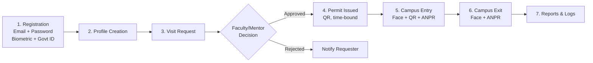
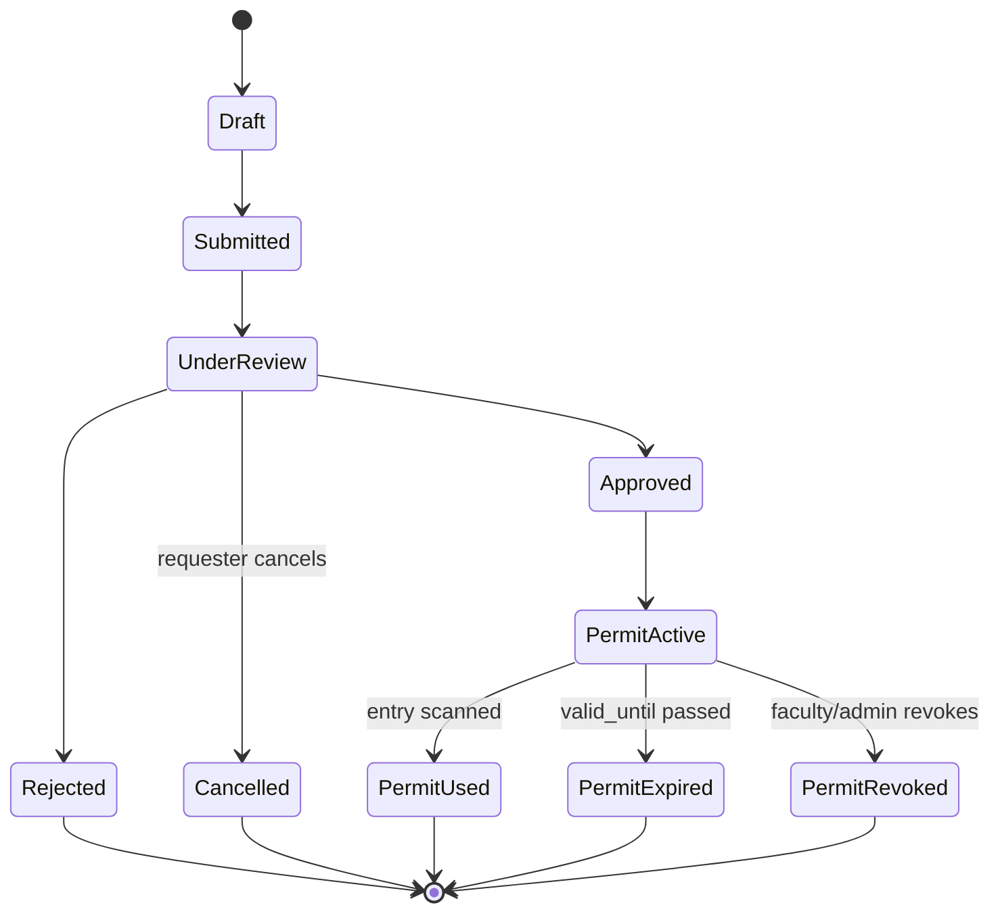
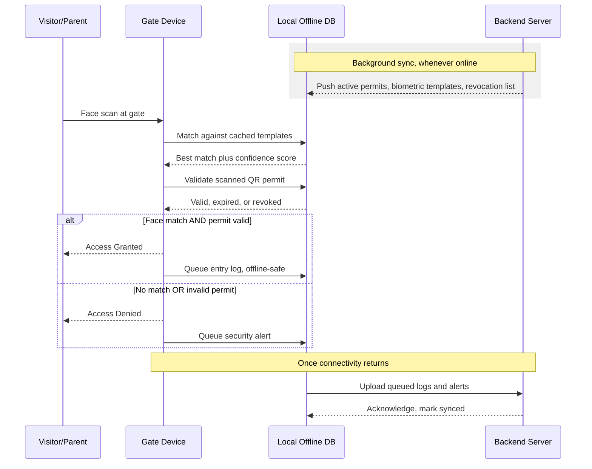
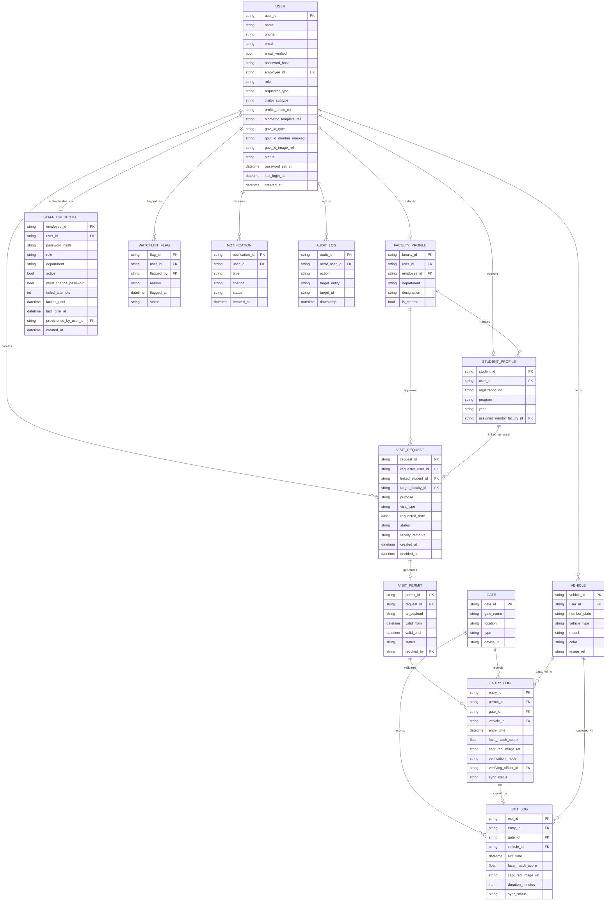
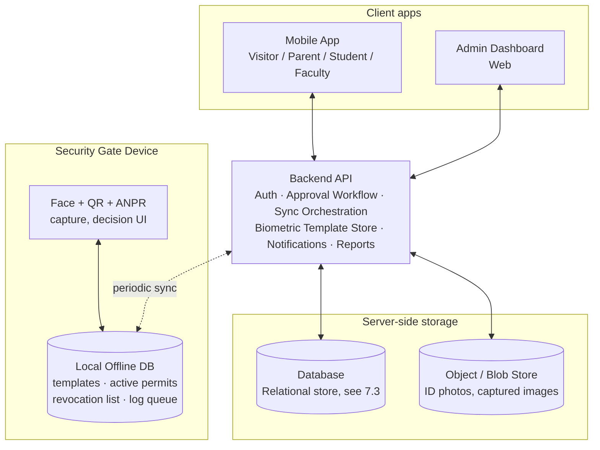

# VISION — Design Document

**VIT Intelligent Surveillance & Identity Operations Network**
*UX flows, screen specifications, data model, and system architecture.*

| | |
|---|---|
| **Prepared by** | Saptarshi — B.Tech CSE (Core), VIT-AP University (Reg. No. 24BCE7033) |
| **Companion documents** | `VISION.md` (project source of truth — roles, decisions, architecture, status) · `PRD.md` (requirements, scope, priorities) |
| **Version** | 1.1 — role and authentication model revised |
| **Status** | Draft for team review |

> **Scope of this document.** It owns screen specifications, information architecture,
> design tokens, the ER data model, the API contract and the RBAC matrix. The canonical
> role and authentication model lives in `VISION.md` §3, and requirements with FR-IDs live
> in `PRD.md`. This document states how the system looks and how its pieces fit together,
> not what it must do or why the stack was chosen.

---

## 1. Design Principles

1. **Offline-first, not offline-tolerant.** The gate must produce a correct access decision with zero connectivity — this shapes almost every choice below, not just a "sync later" afterthought.
2. **Hands-free where it counts.** Biometric capture and gate verification should need no button presses — pose-triggered auto-capture, the way modern selfie-verification flows work.
3. **Low-literacy-friendly.** Many parents, vendors, and delivery personnel are not app-fluent. Minimize typing, maximize guided/visual interaction, and always provide an assisted fallback.
4. **Transparency builds trust.** A requester should always see *why* they're pending/denied; a guard should always see a confidence score, not just a pass/fail light.
5. **Speed for the guard, accountability for the override.** The security app is optimized for sub-2-second decisions and big glanceable states, but any manual override demands officer ID + reason, logged.
6. **Swappable core.** Face recognition, ANPR, and even the database are implementation choices behind clean interfaces — never hardcoded assumptions in the UI or API layer, per `PRD.md` §4.4.

---

## 2. Information Architecture

```
Visitor / Parent / Student  (mobile app, shared shell)
├── Onboarding (first run only)
│   Splash → Role Select → Sign Up (email + password) → Verify Email
│         → Biometric Capture → Govt ID Upload → Profile Form → Consent → Done
├── Sign In (email + password, "Sign in with Google" optional, Forgot Password)
├── Home  (active/past requests, quick "New Request")
├── New Visit Request
├── Request Detail / Status Timeline
├── Active Permit (QR)
├── Visit History
├── My Vehicles
├── [Parent only] Linked Student(s)
├── [Student only] Sponsor a Visit
├── Notifications
└── Profile & Settings  (incl. Change Password)

Faculty / Mentor  (mobile app)
├── Sign In (employee ID + password)   ← no self-registration; account is admin-provisioned
├── Request Inbox  (pending, needs my decision)
├── Request Detail  (approve / reject)
├── Approval History
├── My Advisees  [mentor only]
└── Profile & Settings  (incl. Change Password)

Security Staff  (tablet/kiosk app at the gate)
├── Sign In (employee ID + password)   ← shift-scoped; the signed-in officer is attributed to every action
├── Mode Select: Entry ▸ Exit
├── Scan Sequence: Face → Permit QR → Vehicle Plate
├── Decision Screen: Granted / Denied
├── Manual Override (modal, requires reason)
├── Assisted / Walk-in Registration
├── Recent Activity (this shift)
├── Sync Status
└── End Shift / Sign Out

Admin  (web dashboard, responsive)
├── Sign In (employee ID + password)
├── Overview (live "who's on campus", today's stats)
├── User Management
│   ├── Requester accounts (view, suspend, reactivate)
│   └── Staff Provisioning (create faculty/security/admin against an employee ID, reset password, deactivate)
├── Faculty Directory
├── Gate & Device Management
├── Reports & Analytics
├── Watchlist Management
├── Audit Log
└── System Settings
```

---

## 3. Design System Foundations

Carried forward from the VISION infographic's existing branding, formalized into a usable token set.

| Token | Value | Use |
|---|---|---|
| `color/navy-900` | `#0B2545` | Headers, primary nav, primary buttons |
| `color/orange-600` | `#E8720C` | Entry/exit step accents, key CTAs, active states |
| `color/green-600` | `#1E8E3E` | Access granted, approved status, success states |
| `color/red-600` | `#D93025` | Access denied, rejected, blacklist alerts |
| `color/blue-500` | `#2F6FED` | Informational, User/core entity accents |
| `color/purple-500` | `#7B4FE0` | Logs / history accents (matches ER diagram's log-entity color) |
| `color/gray-50…900` | neutral scale | Backgrounds, text, borders |

**Full Material-style ramp** (generated palette "Vision Institutional Secure", used by the implemented neumorphic components). The tokens above are the brand anchors; these are the surface and state roles derived from them:

| Group | Tokens |
|---|---|
| Surfaces | `surface` `#f9f9f9` · `surface-dim` `#dadada` · `surface-container-lowest` `#ffffff` · `surface-container-low` `#f3f3f3` · `surface-container` `#eeeeee` · `surface-container-high` `#e8e8e8` · `surface-container-highest` `#e2e2e2` |
| On-surface | `on-surface` `#1a1c1c` · `on-surface-variant` `#44474e` · `inverse-surface` `#2f3131` · `inverse-on-surface` `#f1f1f1` |
| Outlines | `outline` `#74777f` · `outline-variant` `#c4c6cf` |
| Primary | `primary` `#001026` · `on-primary` `#ffffff` · `primary-container` `#0b2545` · `on-primary-container` `#778db2` · `inverse-primary` `#b1c7f0` |
| Secondary | `secondary` `#984700` · `on-secondary` `#ffffff` · `secondary-container` `#fc8121` · `on-secondary-container` `#5f2a00` |
| Tertiary | `tertiary` `#1d0b00` · `tertiary-container` `#3c1d00` · `on-tertiary-container` `#b38259` |
| Error | `error` `#ba1a1a` · `on-error` `#ffffff` · `error-container` `#ffdad6` · `on-error-container` `#93000a` |
| Semantic | `success-green` `#1E8E3E` · `error-red` `#D93025` · `info-blue` `#2F6FED` · `data-purple` `#7B4FE0` |

Note the deliberate relationship: `primary-container` `#0b2545` is the brand navy from the
table above, and `secondary-container` `#fc8121` is a lightened form of the brand orange —
the ramp extends the branding rather than replacing it.

- **Typography:** one clean humanist sans-serif (Inter, Roboto, or system default) — display weight for headers, regular for body, tabular figures for timestamps/plate numbers.
- **Iconography:** consistent line-icon set matching the infographic (shield, face-scan frame, QR, car, checkmark, bar chart) — avoid mixing icon styles between screens.
- **Core components (reused across all roles):**
  - **Status chip** — pill badge, color-coded (Submitted=gray, Under Review=blue, Approved=green, Rejected=red, Expired=gray-strike)
  - **Permit card** — large QR, validity countdown, permit ID, tap-to-expand
  - **Profile avatar + verification badge** — small check overlay once biometric enrollment is complete
  - **Bottom tab bar** — mobile roles (Visitor/Parent/Student/Faculty)
  - **Left sidebar nav** — Admin web + Security tablet (larger surface, persistent nav)
  - **Empty state pattern** — icon + one-line explanation + primary action, never a bare blank screen
  - **Alert banner** — sticky top banner for offline mode, sync-pending, or security alerts

---

## 4. Core User Flows

### 4.1 End-to-end flow



### 4.2 Visit request lifecycle



### 4.3 Offline gate verification



---

## 5. Screen Specifications by Role

### 5.1 Shared Onboarding (Visitor, Parent/Guardian, Student)

`Splash → Role Select → Sign Up (email + password) → Verify Email → Biometric Capture → Govt ID Upload → Profile Form → Consent → Done`

**Splash**
*Purpose:* brand entry point.
*Key elements:* VISION logo/shield mark, tagline "Every Entry Verified, Every Visit Secured", "Get Started" CTA, "I have an account → Sign in" link.

**Role Select**
*Purpose:* route into the correct profile shape, and separate the two authentication tracks before any credential is asked for.
*Key elements:* three large tappable cards for the roles that self-register — **Visitor**, **Parent/Guardian**, **Student**. Visitor selection reveals a secondary chip row: General/Guest, Alumni, Vendor/Contractor, Guest Faculty/External Examiner, Student from another institution.
Below the cards, visually separated by a divider and a quieter treatment, a single text link: **"Staff, Security or Admin? Sign in with your employee ID"** → §5.5a.
*Rationale:* the link is deliberately understated. Institutional accounts cannot be created here, so presenting staff as a fourth equal card would invite people to tap it expecting to sign up.

**Sign Up (email + password)**
*Purpose:* create the account. Primary credential for every self-registering role.
*Key elements:* email field (inline format validation, and an inline "this address is already registered → Sign in" affordance rather than a blocking error), password field with a show/hide toggle and a strength meter, confirm-password field, checkbox for terms — biometric consent is **not** bundled here, it has its own screen later.
*Student variant:* an institutional email domain is recognised and confirmed inline ("Recognised as a VIT-AP student"), so the person knows their account will carry student privileges before they finish.
*Secondary path:* a "Sign in with Google" button below a divider, offered as a convenience only. Choosing it skips the password fields and lands on the same Verify Email step, already verified.
*Errors:* weak password, mismatched confirmation, address already in use, and offline — each stated in plain language next to the field that caused it.

**Verify Email**
*Purpose:* confirm the address is real before a visit request can be submitted (`PRD.md` FR-REG-01a).
*Key elements:* the address the link was sent to, a "Resend" action with a visible cooldown, a "Wrong address? Change it" link, and an explanation that onboarding can continue now but a request cannot be submitted until this is done. Auto-advances when verification is detected.
*Rationale:* blocking the whole of onboarding on an email round-trip is where people abandon. Blocking only the request keeps the pressure where it matters.

**Sign In**
*Purpose:* return to an existing account.
*Key elements:* email, password, "Sign in" primary action, "Forgot password?" link, and the optional "Sign in with Google" button. On success, the role carried by the account determines which shell opens — the person does not pick a role at sign-in, only at signup.

**Forgot Password**
*Purpose:* self-service recovery for the email track only.
*Key elements:* email field, confirmation that a link has been sent — worded identically whether or not the address exists, so the screen cannot be used to discover who holds an account. Staff cannot recover this way; the screen says so and points them at their admin (`PRD.md` FR-PROF-07).

**Biometric Capture — the core enrollment screen**
*Purpose:* capture a robust facial template without needing per-user model training, styled like the guided selfie-verification flows in apps such as Hinge/Bumble.
*Layout:*
- Full-screen front-camera preview, screen dimmed outside a centered oval guide frame. The oval is **portrait-oriented and face-sized** — roughly 65% of screen width, 1.3× that in height — so the person frames their face alone rather than their upper body. A circular guide reads as a full-body frame and people step back from it.
- Guide-frame ring color communicates state, four steps: **gray** = searching ("Looking for your face…"), **amber, gently pulsing** = detected but not aligned ("Position your face in the oval"), **green** = aligned ("Hold steady"), **blue** = capturing. Colour transitions are animated rather than snapping, so the ring reads as responding to the person rather than flickering.
- A **3-2-1 countdown** renders large in the centre of the oval once alignment holds, with capture at zero — the countdown is what makes an automatic capture feel deliberate instead of startling, and gives a moment to correct.
- Persistent tips below the frame: remove glasses, ensure good lighting, look straight ahead.
- **Auto-capture sequence, no shutter button:**
  1. "Look straight ahead" — frontal capture
  2. "Slowly turn your head left"
  3. "Slowly turn your head right"
  4. "Tilt your chin up slightly" (or a blink prompt)
  - Each pose auto-captures after holding correctly for ~1 second; a segmented ring around the frame fills as each of the 4 steps completes, with a short haptic tick per step.
- Inline guard-rail messages for poor lighting, occlusion (mask/sunglasses/hat), or more than one face in frame — capture pauses, plain-language fix-it text shown, no technical error codes.
- Completion: brief "Processing..." spinner, then a success state (checkmark animation) with a one-line reassurance: data is encrypted and used only for campus verification.
*Edge case:* after 3 failed attempts, screen offers "Having trouble? Get help at the security desk" — routes to the assisted registration path (§5.6).
*Note:* this same lightweight, pretrained-embedding approach (no bulk per-user training) is what makes fast enrollment possible — see §7 for model options.

**Government ID Upload**
*Purpose:* identity proof, stored as an image only — no OCR/eKYC required for MVP.
*Key elements:* ID type selector (Aadhaar / Voter ID / Driving Licence / Passport / College ID — the last shown only for Student/Alumni), "Take Photo" (camera opens with a rectangular document-guide overlay) or "Upload from Gallery", preview with Retake/Confirm, one-line privacy note (visible only to Security and Admin, for identity verification).
*Deliberately out of MVP scope:* auto-extracting name/ID number via OCR — listed as a future enhancement in §12, not core, to match "just the picture" from the original spec.

**Profile Form**
*Purpose:* the remaining structured fields.
*Key elements:* name and contact number, plus role-specific fields. Email is already held from signup and is shown read-only rather than re-asked.
- *Parent/Guardian:* "Who are you visiting?" — searchable student lookup (name/registration number), can add more than one linked student.
- *Visitor:* purpose category hint field, company/institution name (for Vendor/Contractor or Guest Faculty subtypes).
- *Visitor, subtype External Student:* home institution, project/internship title, expected duration, and the supervising VIT-AP faculty member who will approve access.
- *Student:* registration number, program, year (assigned mentor is looked up automatically, not entered by hand).

**Consent**
*Purpose:* explicit, separate opt-in for biometric processing — not bundled silently into generic T&Cs.
*Key elements:* plain-language explanation of what's captured and why, a dedicated biometric-consent checkbox distinct from the general terms checkbox, link to full privacy policy.

**Done**
*Purpose:* confirmation and handoff into the app proper.
*Key elements:* "You're registered" confirmation, unique User ID displayed, CTA into Home.

---

### 5.2 Visitor App

**Home**
*Purpose:* command center for requests.
*Key elements:* prominent "New Visit Request" CTA, list of requests with status chips (most recent first), empty state on first use ("No requests yet — create your first one").

**New Visit Request**
*Purpose:* the core ask.
*Key elements:* purpose (short text or category dropdown), visit type (On-Campus / Meeting / Event / Delivery / Maintenance — the last two relevant to Vendor subtype), searchable "Concerned Faculty" directory field, date + expected time window pickers, optional "Add vehicle details" expandable section (plate, type, model, color — pre-fills from My Vehicles if already saved).
*Primary action:* Submit.

**Request Detail / Status Timeline**
*Purpose:* answer "where does my request stand."
*Key elements:* vertical timeline — Submitted → Under Review → Approved/Rejected, faculty remark shown if rejected, "Cancel Request" available while still pending.

**Active Permit**
*Purpose:* what gets shown/scanned at the gate.
*Key elements:* large centered QR, validity window with live countdown, permit ID, requester + purpose summary, a persistent "Available Offline" indicator confirming the permit is cached locally, not dependent on a live connection at the gate.

**Visit History**
*Purpose:* past-visit record.
*Key elements:* chronological list, tap into a completed visit for entry/exit timestamps and duration.

**My Vehicles**
*Purpose:* reusable vehicle records.
*Key elements:* add/edit/remove plate, type, model, color; default vehicle toggle for repeat visits.

**Profile & Settings**
*Purpose:* self-service account management.
*Key elements:* view/edit basic info, "Re-scan biometric" action, language preference, notification preferences, logout.

**Notifications**
*Purpose:* status changes surfaced without needing to poll the app.
*Key elements:* chronological feed — request submitted, approved/rejected, permit issued, entry logged, exit logged, permit expiring soon.

---

### 5.3 Parent / Guardian App

Same shell and screens as §5.2, with two differences that matter enough to call out on their own:

**Linked Student(s)**
*Purpose:* the field that makes approval-routing actually work.
*Key elements:* list of added students (ward), each searchable/added by name + registration number during onboarding or from Profile later; selecting one during a New Visit Request auto-suggests that student's assigned mentor as the approver, with a clearly visible "Choose a different faculty instead" override — matching the source rule that parent-visit approval can come from either the mentor or any faculty member.

**New Visit Request (parent variant)**
*Difference from the Visitor version:* the "Concerned Faculty" field is pre-populated (not blank) once a linked student is chosen, removing the need for a parent to search a faculty directory blind.

---

### 5.4 Student (Sponsor) App

Enrolled VIT-AP students register through the same shared onboarding (§5.1) — email and password, with their institutional address recognised at signup — and get the lightest-weight app surface of the three self-registering roles. They are **not gate-tracked**: they already hold an ID card, and their account exists for one active function, sponsoring a parent or guardian's visit (`PRD.md` §4.3).

Biometric capture and government ID upload are therefore **skipped** for this role; onboarding runs Splash → Role Select → Sign Up → Verify Email → Profile Form → Done.

**Home**
*Key elements:* "Sponsor a Visit" CTA front and center, list of visits the student has sponsored with status chips.

**Sponsor a Visit**
*Purpose:* let a student initiate a visit request for a parent/guardian who may not have the app yet — closes a real adoption gap (an older parent isn't going to install and onboard through a full biometric flow before their first-ever visit).
*Key elements:* parent/guardian name + contact, purpose, date/time window, target faculty (mentor auto-suggested, same override available as §5.3). On submission, the *parent's* biometric enrollment still has to happen — either the parent completes it remotely via a shared link/SMS before arriving, or via assisted registration at the security desk on arrival (§5.6). The sponsored request and the parent's eventual account are linked once the parent completes their own minimal registration.
*Status note:* this flow is specified here because it directly resolves a gap in the source material, but is reasonable to treat as a fast-follow rather than PoC day-one — see `PRD.md` §13 Phase 2.

**My Sponsored Visits**
*Key elements:* status tracking for anything the student has initiated on a parent's behalf.

**Profile & Settings**
*Key elements:* standard profile management, same as §5.2.

---

### 5.5a Staff Sign-In (shared by Faculty, Security and Admin)

One screen serves all three institutional roles; the account's own role decides which shell opens after a successful sign-in, so the person never picks a role.

*Purpose:* institutional identity, keyed on the identifier VIT-AP already uses for its staff.
*Key elements:* employee ID field (uppercased and trimmed as typed, since IDs are printed on cards in a fixed case), password field with show/hide, "Sign in" primary action.
*Deliberately absent:* any "create an account" or "sign up" affordance, and any Google button. Institutional accounts are provisioned by an admin (`PRD.md` FR-ADM-06) and cannot be self-created — offering a signup link here would be a dead end that looks like a bug.
*Forgot password:* a line reading "Forgotten your password? Contact your system administrator." Staff recovery is admin-initiated (`PRD.md` FR-PROF-07), because an employee ID is not an email address and there is nowhere to send a self-service link.
*Error states:* unknown employee ID and wrong password produce the **same** message — "Employee ID or password is incorrect" — so the screen cannot be used to discover which IDs exist. A deactivated account says so explicitly and names the admin contact, since that is a different problem and silently failing would waste the person's time. A locked account (`PRD.md` FR-PROF-08) shows the remaining lockout time.
*First sign-in / after an admin reset:* forced password change before the shell opens.

---

### 5.5 Faculty / Mentor App

**Sign In** — see §5.5a. Employee ID + password.

**Request Inbox**
*Purpose:* the single most important screen for this role — it's where the "faculty as bottleneck" problem gets solved or doesn't.
*Key elements:* pending requests list, sorted newest-first, each row showing requester photo thumbnail, name, category badge (Visitor/Parent/Student-sponsored), and purpose at a glance — decision-ready without opening every row.

**Request Detail**
*Purpose:* enough context to decide confidently in one screen.
*Key elements:* requester photo + verified-biometric badge, category and subtype, purpose, requested date/time window, government-ID-on-file indicator (not the image itself unless explicitly opened — see §9 access rules), linked student context if this is a parent visit, past-visit history with this requester if any, **Approve** / **Reject** buttons, remark field (optional on approve, required on reject).

**Approval History**
*Key elements:* searchable log of past decisions, filterable by date/status.

**My Advisees** *(mentor-designated faculty only)*
*Purpose:* visibility into which students list them as mentor, since that's what drives auto-suggested approval routing for parent visits.
*Key elements:* advisee list, each showing any active/pending parent-visit requests linked to them.

**Profile & Settings**
*Key elements:* department/designation (admin-managed, view-only here), notification preferences, logout.

---

### 5.6 Security Staff App (Gate Device)

Designed for a tablet or kiosk mounted at the gate rather than a phone in-hand — bigger glanceable states, camera positioned for consistent framing.

**Sign In** — see §5.5a. Employee ID + password, with two gate-specific behaviours:
- *Shift-scoped session:* the signed-in officer is attributed to every scan, override and flag recorded for the rest of the shift, and the ID is shown persistently in the header so it is never ambiguous who is operating the device. "End Shift" signs out and clears the session.
- *Offline sign-in:* the gate cannot assume connectivity (`PRD.md` NFR-AVAIL-01), so a recently signed-in officer's credential is validated against the device's local cache when the network is unavailable. The cache is refreshed on every successful online sign-in and on every sync, and it expires — an officer who has not signed in on that device within the cache window must be online at least once. Deactivations propagate at the next sync, which is the accepted trade-off for a gate that keeps working when the link is down.

**Mode Select**
*Key elements:* two large buttons — **Entry** / **Exit** — sets context for the scan sequence that follows.

**Scan Sequence: Face → Permit QR → Vehicle Plate**
*Purpose:* the core verification loop, must complete in under 2 seconds per `PRD.md` NFR-PERF-01, fully offline-capable.
*Flow:*
1. **Face scan** — live camera view, auto-captures on stable detection (no manual shutter), matched against the locally cached template store.
2. **Permit QR scan** — camera switches to QR-read mode, validates the signed payload locally (signature check, validity window, revocation-list check — all against the local offline DB, see §7.4).
3. **Vehicle plate capture** (if the visit has a vehicle, or on-the-spot if the visitor arrives with one unregistered) — camera captures the plate, ANPR extracts the number; low-confidence reads fall to a manual-entry field rather than blocking the flow.

**Decision Screen**
*Purpose:* the moment that matters most for gate throughput — must be unambiguous at a glance.
*Key elements:*
- **Access Granted:** full-screen green, large checkmark, requester name + photo, permit purpose, auto-dismisses after a few seconds or on next scan.
- **Access Denied:** full-screen red, large X, reason shown plainly (no match / permit expired / permit revoked / blacklist flag), triggers an audible alert, does **not** auto-dismiss — requires officer acknowledgment.
- Both states show the face-match confidence score in smaller text below the primary result, so the officer isn't just trusting a black-box pass/fail.

**Manual Override**
*Purpose:* accountable exception handling — this is the pressure-relief valve for false rejects and edge cases, and it's designed to be used *and logged*, not designed to be avoided.
*Key elements:* modal triggered only from a Denied state, requires officer PIN re-entry + a mandatory reason (free text or quick-pick: "Known repeat visitor" / "Technical issue" / "Faculty verbal confirmation" / "Other"), writes an `Entry_Log` row flagged `verification_mode: manual_override` with `verifying_officer_id` attached, surfaces in the Admin audit log (§8 `AUDIT_LOG`, `PRD.md` FR-ENT-07).

**Assisted / Walk-in Registration**
*Purpose:* covers visitors without a pre-existing account — a real, common case for vendors, delivery personnel, and first-time parents.
*Key elements:* condensed on-the-spot version of §5.1's onboarding, run by the officer on the gate tablet: biometric capture + govt ID photo + minimal profile fields, then routes into a visit request that still needs faculty approval before entry is granted (no bypass of the approval step, just a faster on-ramp into the system).

**Recent Activity**
*Key elements:* this-shift log of entries/exits/denials, useful for a quick sanity check without leaving the gate app.

**Sync Status**
*Purpose:* answer "is my local data current" without ambiguity.
*Key elements:* last-synced timestamp, stale-data warning banner if beyond a configurable threshold (e.g., > 2 hours), manual "Sync Now" action, queued-upload counter (logs/alerts waiting to push once online).

---

### 5.7 Admin Dashboard (Web)

**Sign In** — see §5.5a. Employee ID + password, same screen and same rules as the mobile staff sign-in.

**Overview**
*Key elements:* live "who's currently on campus" count (open entry sessions with no matching exit), today's entries/exits/denials at a glance, recent security alerts feed.

**User Management — Requesters**
*Key elements:* searchable user table (name, category, status), view profile detail, suspend/reactivate account, view a user's flag history.

**User Management — Staff Provisioning**
*Purpose:* the only way a Faculty, Security or Admin account comes into existence (`PRD.md` FR-ADM-06). This screen is the counterpart to the absent signup link in §5.5a.
*Key elements:*
- Staff table listing employee ID, name, role, department, status (active / deactivated / locked), and last sign-in.
- **Create account:** employee ID (uniqueness checked inline, including against previously deactivated IDs, which are never reissued), name, role selector (Faculty / Security / Admin), department, and an initial password that the account holder must change on first sign-in.
- **Reset password:** sets a new initial password and forces a change on next sign-in. The dashboard displays it once, for the admin to hand over directly — it is never emailed, because an employee ID has no verified address attached to it.
- **Deactivate:** revokes gate and approval access immediately rather than at the next token expiry (`PRD.md` FR-ADM-07). The confirmation dialog names what the person currently holds — pending approvals awaiting them, an open gate shift — so the admin sees what deactivating will interrupt.
- Every action here writes to the audit log with the acting admin's own employee ID.
*Deliberately constrained:* an admin cannot deactivate their own account, and the system refuses to deactivate the last remaining active admin — otherwise the console locks everyone out with no way back in short of the seed script.

**Faculty Directory**
*Key elements:* add/edit faculty (department, designation), assign/reassign student mentors, activate/deactivate approval access.

**Gate & Device Management**
*Key elements:* register/rename/deactivate gates, view per-device sync health, assign device IDs.

**Reports & Analytics**
*Key elements:* filterable visit history (date, gate, category, faculty host), CSV export, charts — visits by day/category/gate, average visit duration, denied-entry attempts, peak hours.

**Watchlist Management**
*Key elements:* flag a user with a reason, view active flags, clear a flag (logged to audit trail).

**Audit Log**
*Key elements:* full chronological record of admin/security actions — approvals, overrides, revocations, blacklist changes — actor, action, target, timestamp.

**System Settings**
*Key elements:* configurable thresholds (permit validity default window, faculty response SLA, stale-sync warning threshold), accepted government-ID types, gate operating hours.

---

## 6. Data Model

Thirteen entities. The core set (`User`, `Visit_Request`, `Faculty`/`Faculty_Profile`, `Visit_Permit`, `Vehicle`, `Gate`, `Entry_Log`, `Exit_Log`) comes directly from the original ER diagram; `Student_Profile`, `Watchlist_Flag`, `Notification`, and `Audit_Log` are additions justified in `PRD.md` §0, and `Staff_Credential` is added here to carry the employee-ID authentication track.



### Field notes worth flagging

- `USER.role` — system access level: `visitor | parent | student | faculty | security | admin`. `visitor_subtype` (`general | alumni | vendor | guest_faculty | external_student`) applies only when `role = visitor`. This split is what resolves the flat `Category` field's ambiguity from the original ER diagram — see `PRD.md` §0, item 2.
  **The stored role is not the authorization source.** Authorization reads the role from the server-issued claim inside the verified token (§9.1); the column exists so an admin can see and change it, not so a request can assert it.
- `USER.password_hash` / `STAFF_CREDENTIAL.password_hash` — a salted one-way hash (bcrypt or argon2), never plaintext and never reversible encryption (`PRD.md` NFR-SEC-04). Neither field is ever returned by an API, logged, or synced to a gate device in a readable form.
- `USER.employee_id` — null for every self-registering role, unique and immutable for staff. A deactivated employee ID stays in the table precisely so it cannot be reissued to a different person (`PRD.md` FR-ADM-08); the account is marked inactive rather than deleted, which also keeps historic audit-log entries resolvable to a real person.
- `STAFF_CREDENTIAL` — deliberately a separate entity from `USER`, keyed on the employee ID rather than the user ID. Sign-in has to find an account from an employee ID before any user record is known, so the credential lookup needs its own key; keeping it separate also means the credential record can be locked, reset or deactivated without touching the profile, and it is the only entity holding lockout state.
- `STAFF_CREDENTIAL.provisioned_by_user_id` — who created this account. Institutional access is granted by a person, and the audit trail should say which one.
- `USER.biometric_template_ref` — a pointer to an **encrypted embedding vector**, never a raw image used for matching. Raw images (`captured_image_ref` on log entries) are kept as an audit trail, separately, with tighter access control.
- `VISIT_PERMIT.qr_payload` — a signed/encrypted token (not a plain visible code), so the QR image alone can't be screenshotted and reused to forge a valid permit — see §9.
- `STUDENT_PROFILE.assigned_mentor_faculty_id` — the field that makes parent-request auto-routing work end to end.
- `ENTRY_LOG.verification_mode` / `verifying_officer_id` — populated only on manual override, giving every bypass a name and reason attached.

---

## 7. System Architecture

### 7.1 Components



The gate device is the one component that must operate correctly with the top two layers completely unreachable — everything about §7.4 exists to make that true.

### 7.2 Technology shortlist — reference only, not a mandate

Every row below is a validated starting point from the original proposal, kept swappable per `PRD.md` §4.4 — **except the two marked "Decided"**, which are recorded decisions with rationale in `VISION.md` §6.

| Layer | Candidates | Note |
|---|---|---|
| Mobile client | **React Native + Expo — Decided** | Flutter was evaluated and rejected: none of the project's difficulties were caused by the framework, and a port would mean rebuilding ~12,300 lines and a hand-built neumorphic component library that has no direct Flutter analogue. Full reasoning, and the conditions that would reopen it, in `VISION.md` ADR-001 |
| Backend API | FastAPI, Node.js (Express) | FastAPI's async support is a natural fit if ML inference is called server-side for any stage |
| Database | PostgreSQL / MySQL, Turso (SQLite Cloud), Firebase Firestore | **Worth flagging:** the schema in §6 is strongly relational (FK-heavy, multi-table joins for approval routing) — a relational engine (Postgres/MySQL/Turso) is the more natural fit; Firestore would need denormalization to serve the same queries efficiently. Both are listed because the source docs suggested both; the trade-off above is the reasoning to weigh when picking. |
| Auth | **Firebase Authentication — Decided** | Serves all three credential paths. Email + password natively; Google as an optional provider; and employee ID + password via a backend-issued **custom token** — the backend verifies the employee ID against a bcrypt hash, mints a custom token, and the app exchanges it for an ordinary session. Every path therefore ends in one token type and one verification routine. `VISION.md` ADR-002 and ADR-003 |
| Password hashing | bcrypt (`bcryptjs`), or argon2 | Server-side only. Never in the app, never on a gate device |
| Face detection | MediaPipe, RetinaFace | Detection/alignment stage, feeds into the recognition model below |
| Face recognition | OpenCV + FaceNet, ArcFace, or other pretrained-embedding models (e.g., MobileFaceNet for on-device speed) | Embedding-based, one-time enrollment, no bulk per-user training — matches the "same as hostel-mess face-scan systems" approach described in the source brief |
| ANPR | YOLO-family detector (YOLOv11, or YOLO26 for a lighter/newer detector if a small custom plate dataset is collected, similar in spirit to a single-class detector) + EasyOCR for character recognition; OpenALPR as an all-in-one alternative | Two-stage (localize plate, then OCR) tends to be more tunable than an all-in-one black box |
| QR | ZXing | Standard, works offline |
| Cloud storage | Firebase Storage | For govt-ID photos and captured log images |
| Notifications | Firebase Cloud Messaging | Push; SMS/email as fallback channel per FR-NOT-03 |
| Gate hardware | Android tablet/kiosk (PoC), scaling later to a dedicated edge board (e.g., Raspberry Pi, or a more capable board like a Kria-class SBC) if on-device inference load grows | Named in the original proposal as a future-phase item; a tablet is the pragmatic PoC starting point since it bundles camera + compute + display in one unit |

### 7.3 Why relational

Given `Visit_Request → Visit_Permit → Entry_Log → Exit_Log` is a genuine foreign-key chain, and reporting needs (§5.7) are mostly "join across these tables and filter" — a relational database avoids re-solving joins in application code that a NoSQL document store would otherwise push onto the backend layer.

### 7.4 Offline sync design

This is the part of the system that can't be an afterthought — it's the actual point of the "offline gate" requirement.

**Downstream sync (server → gate device), periodic when online:**
- Active permits (with QR payload, validity window)
- Revocation list (permits and blacklist flags that changed since last sync)
- Biometric templates (encrypted embeddings only)

**Upstream sync (gate device → server), whenever connectivity is available:**
- Queued entry/exit logs, tagged `sync_status: pending` until acknowledged
- Queued security alerts (denials, blacklist hits, overrides)

**Conflict rule:** server state always wins for permits/revocations/templates on reconnect (the gate device never has more authority over "is this permit valid" than the server does) — but locally queued logs are strictly additive; a sync never discards or overwrites a log the gate device already captured.

**Staleness handling:** the gate device surfaces a visible warning (§5.6 Sync Status) once cached data crosses a configurable age threshold, so an officer knows to flag it rather than trust silently-stale data indefinitely.

### 7.5 Optional hardware extension

The original workflow describes "physical barriers open" on a granted vehicle entry. Not required for the PoC, but if pursued: the gate device can drive a relay/actuator on a granted decision — a small, self-contained addition on top of the same decision event already being produced, not a redesign.

---

## 8. API Surface (high-level)

Illustrative, not a locked contract — grouped by module to match §7's components and `PRD.md` §7's FR modules.

```
Auth  — every path below ends in the client holding one token type; see §9.1
  POST /auth/register              email + password self-signup.
                                   Role is clamped server-side to visitor|parent|student,
                                   whatever the body claims.
  POST /auth/login                 email + password
  POST /auth/staff/login           employee ID + password → custom token,
                                   exchanged by the client for a session
  POST /auth/password/reset        request a reset link (email track only)
  POST /auth/password/change       change own password, current password required
  POST /auth/verify-email/resend
  GET  /auth/me                    resolve the caller from their token
  GET  /auth/session               uid, role and employee ID from the verified token.
                                   Used by the biometric service to check its callers

Admin — Staff provisioning   (admin role only)
  POST   /admin/staff                       provision faculty/security/admin
  GET    /admin/staff                       list, filter by role/status
  PATCH  /admin/staff/{employee_id}         update role/department, deactivate
  POST   /admin/staff/{employee_id}/reset-password

Users
  POST /users                      (register)
  GET  /users/{id}
  PATCH /users/{id}
  POST /users/{id}/biometric       (enrollment upload)
  POST /users/{id}/govt-id         (ID photo upload)

Vehicles
  POST /vehicles
  GET  /vehicles?user_id=

Visit Requests
  POST  /visit-requests
  GET   /visit-requests/{id}
  PATCH /visit-requests/{id}       (approve / reject / cancel)
  GET   /faculty?search=           (directory lookup)

Permits
  GET  /permits/{id}
  POST /permits/{id}/revoke

Gate Sync
  GET  /gates/{id}/sync            (pull permits, templates, revocations)
  POST /gates/{id}/entry-logs      (batch upload from offline queue)
  POST /gates/{id}/exit-logs

Watchlist
  POST   /watchlist
  DELETE /watchlist/{id}

Reports
  GET /reports/visits
  GET /reports/analytics
  GET /audit-logs
```

---

## 9. Security & Privacy Design

### 9.1 Role-based access control

**The role comes from the token, and only from the token.** Every request carries a
server-issued token with the account's role inside it as a signed claim. Authorization
reads that claim. A role sent in a request body, held in client state, or stored on the
device is never consulted — those are inputs a caller controls, and treating one as an
authorization source is what allows a user to promote themselves.

| Action | Visitor/Parent | Student | Faculty/Mentor | Security | Admin |
|---|:---:|:---:|:---:|:---:|:---:|
| Self-register an account | ✅ | ✅ | — (admin-provisioned) | — (admin-provisioned) | — (admin-provisioned) |
| Sign in with email + password | ✅ | ✅ | — | — | — |
| Sign in with employee ID + password | — | — | ✅ | ✅ | ✅ |
| View / edit own profile | ✅ | ✅ | ✅ | ✅ | ✅ |
| Change own password | ✅ | ✅ | ✅ | ✅ | ✅ |
| Reset a forgotten password unaided | ✅ (email link) | ✅ (email link) | — (admin resets) | — (admin resets) | — (another admin resets) |
| Submit visit request | ✅ | ✅ (sponsor) | — | — | — |
| Approve/reject a request | — | — | ✅ (own only) | — | ✅ |
| View own request/permit | ✅ | ✅ | — | — | — |
| Scan/verify at gate | — | — | — | ✅ | — |
| Manual override | — | — | — | ✅ (logged) | ✅ |
| View own entry/exit history | ✅ | — | ✅ (own approvals) | — | ✅ (all) |
| View all entry/exit logs | — | — | — | ✅ (shift-scoped) | ✅ (full) |
| Read another user's biometric record | — | — | — | — | ✅ (audited) |
| Provision / deactivate staff accounts | — | — | — | — | ✅ |
| Manage users/faculty/gates | — | — | — | — | ✅ |
| Blacklist a user | — | — | — | ✅ (flag only) | ✅ (flag + clear) |
| View audit log | — | — | — | — | ✅ |

### 9.1a Credential security

- **Storage.** Passwords are held only as salted one-way hashes — bcrypt or argon2, server-side (`PRD.md` NFR-SEC-04). No plaintext, no reversible encryption, in the database, in logs, in error messages, or in a sync payload to a gate device.
- **Transit.** A password crosses the network exactly twice in the system's life: at signup and at sign-in, over TLS. Nothing else transmits one, and no endpoint returns one.
- **Authorization.** The role claim is written by the server when an account is created or its role changes, and is re-read from the verified token on every request. It is never accepted from a client.
- **Token verification is all-or-nothing.** A token that fails signature verification is rejected. There is no permissive fallback that inspects an unverified payload — a fallback like that quietly converts every other control here into decoration, since a caller can then assert any identity they like (`PRD.md` NFR-SEC-05).
- **Lockout.** Repeated failed sign-ins lock an account for a growing interval, recorded on the credential record and surfaced to the admin console. Sign-in endpoints are rate-limited independently of the per-account lock, so an attacker spreading attempts across many accounts is also throttled.
- **Enumeration.** Sign-in and password-reset responses do not reveal whether an account exists — same message, same timing, whether the identifier is unknown or the password is simply wrong.
- **Session end.** Signing out clears the session on the device, not just the cached profile. A cleared cache with a live session is not a sign-out.
- **On-device storage.** Tokens live in the platform's secure keystore, never in general-purpose app storage. Passwords are never persisted on a device at all.

### 9.2 Biometric data handling

- Enrollment stores an **encrypted embedding vector**, not a raw face image, as the object actually used for matching — the raw enrollment photo (if retained at all) is for human-verification fallback only, access-restricted the same as government ID images.
- Templates pushed to gate devices remain encrypted at rest on-device; matching happens against the decrypted-in-memory vector at scan time, not against a plaintext file on disk.
- All transmission — enrollment upload, sync push/pull, log upload — is TLS-encrypted in transit.

### 9.3 QR permit integrity

The QR payload is a signed (and optionally encrypted) token — e.g., contains the permit ID, validity window, and a server-issued signature the gate device can verify against a locally cached public key, entirely offline. This is what "encrypted QR code scanning" in the original NFRs concretely means: a photo of someone else's QR code doesn't produce a forged permit, because the signature won't validate against a request/date it wasn't issued for, and a revoked permit's ID will appear on the locally synced revocation list regardless of whether the QR itself still "looks" valid.

### 9.4 Government ID handling — an important distinction

This system is designed to store a **photograph of a government ID document as identity proof**, the same way a visitor register or reception desk copy works today — it is **not** performing Aadhaar-number authentication/eKYC against UIDAI's systems, which is a separate, more tightly regulated activity. Practical steps that keep this on the lower-risk side of that line:
- Offer multiple accepted ID types (Aadhaar, Voter ID, Driving Licence, Passport, College ID), not Aadhaar-only, so visitors aren't forced into sharing one specific document.
- Mask the ID number in every UI (`govt_id_number_masked`) — the full image is viewable only by Security/Admin, and that view should itself be access-logged.
- Define a retention window and auto-purge policy rather than keeping ID images indefinitely.

This is general good practice, not a legal compliance certification — for an actual production rollout beyond the academic PoC, get the data-handling design reviewed against India's DPDP Act 2023 (and any applicable UIDAI guidance if Aadhaar images specifically are in scope) by someone qualified to advise on it.

### 9.5 Data retention (proposed default, configurable by Admin — `PRD.md` Open Question 4)

- Entry/exit logs + captured verification images: retain for a defined operational window (e.g., one academic year), then archive or purge.
- Government ID images: shorter retention than logs where feasible, tied to active-registration status.
- Audit log: retained longer than operational data, since its entire purpose is after-the-fact accountability.

---

## 10. Accessibility & Inclusive Design

- **Minimize typing** everywhere a guided/visual interaction can substitute (biometric capture, document-guide camera overlays, dropdowns over free text).
- **Multilingual support** — English, Hindi, and Telugu as a starting set given VIT-AP's location in Amaravati, Andhra Pradesh; language picker surfaced at first launch, not buried in settings.
- **High-contrast mode** for the gate decision screen specifically — it needs to be legible in bright outdoor daylight, not just indoors.
- **Assisted registration** (§5.6) is treated as a first-class path, not a degraded one, given the target users include visitors who may not own a smartphone capable of comfortable self-onboarding.
- **Large touch targets** throughout the Security app, designed for quick taps under time pressure, not precision taps.

---

## 11. Error States & Edge Cases

| Scenario | System behavior |
|---|---|
| Wrong password at sign-in | "Email or password is incorrect" — never which of the two. Failed-attempt counter increments |
| Unknown email or unknown employee ID | Same message and same response time as a wrong password, so the screen cannot be used to enumerate accounts |
| Too many failed attempts | Account locked for a growing interval; the screen states the remaining time rather than repeating the generic failure |
| Signup with an email that already exists | Not a blocking error — the field offers "This address is already registered. Sign in instead?" |
| Email not yet verified | Onboarding continues, but submitting a visit request is blocked with an inline explanation and a "Resend link" action (§5.1) |
| Staff attempts to self-register | No path exists to do so. The Role Select screen offers only sign-in for staff, and the message names the admin as the way to get an account |
| Deactivated staff account signs in | Told plainly that the account is deactivated, with the admin contact — unlike a wrong password, this is not a guessing attack and leaving them to retry wastes their time |
| Staff signs in for the first time, or after an admin reset | Forced password change before the shell opens |
| Staff forgets their password | No self-service path — an employee ID has no verified address to send a link to. Directed to their admin (`PRD.md` FR-PROF-07) |
| Gate device offline at officer sign-in | Validated against the device's local credential cache; an officer who has not signed in on that device inside the cache window must be online once (§5.6) |
| Session expires mid-task | Silent refresh where possible; otherwise the person returns to sign-in with their unsaved input preserved |
| Last remaining admin account is being deactivated | Refused, with an explanation — otherwise the console locks everyone out |
| Face not detected during capture | Inline guidance, no hard failure; retry loop |
| Poor lighting / occlusion at enrollment or gate | Explicit plain-language prompt to fix, capture pauses |
| Face match below confidence threshold, permit otherwise valid | Denied by default; manual override available with logged reason |
| Permit expired at gate | Denied, reason shown as "Permit expired," requester notified separately |
| Permit revoked after issue, before use | Denied at gate once revocation has synced; if device is stale, denial happens on next sync-driven re-check — this is why staleness warnings (§5.6) matter |
| Zero connectivity at gate, no cached data available for a given user | Denied with reason "Not found locally," directs to assisted registration or manual verification |
| Blacklisted user attempts entry, even with a technically valid permit | Denied + alert, blacklist takes precedence over permit validity |
| Duplicate registration attempt (same person, new account) | Flagged for Admin review via biometric similarity check against existing templates, not silently allowed |
| Vehicle plate unreadable by ANPR | Manual plate entry fallback, does not block face/permit verification |
| Vehicle at gate doesn't match pre-registered plate for that request | Logged as a mismatch, does not auto-deny — flagged for officer awareness |
| Exit scan with no matching open entry session | Alert raised, logged as an anomaly for Admin review |
| Faculty never responds to a request | SLA reminder fires (`PRD.md` FR-VIS-11); escalation path is a future-phase decision, see `PRD.md` Open Question 2 |

---

## 12. Future Enhancements

- OCR auto-extraction from the uploaded government ID, pre-filling profile fields (deliberately deferred from MVP per §5.1)
- Refined Sponsor flow: remote biometric enrollment link a student can text/WhatsApp to a parent before arrival
- Auto-approval rules for pre-cleared recurring visitors (e.g., regular vendors)
- Host-initiated invites — faculty pre-registers an expected guest, flipping the request direction
- Hostel entry point + mess-slip verification integration (named directly in the original proposal's future-extensibility list)
- Full student attendance management
- Emergency evacuation headcount mode, using live entry-session data
- Multi-campus / multi-gate scale-out beyond the pilot
- Physical barrier/turnstile actuator integration (§7.5)
- WhatsApp-based permit delivery/sharing
- Voice-guided onboarding prompts for additional accessibility
- Integration with existing VIT ID-card systems for staff/student physical access
- Institutional SSO for staff, replacing employee ID + password if VIT-AP exposes an identity provider (`VISION.md` ADR-003 notes what would change)
- Two-factor authentication for Admin accounts, which hold the widest access in the system
- Self-service password recovery for staff, once a verified institutional email address is held against each employee ID

---

## 13. Appendix

- Wireframes described here are textual/structural specs, not pixel mockups — a Figma pass (already in the original tooling shortlist) is the natural next step once the flows above are validated with the team.
- All Mermaid diagrams in this document (§4, §6) are also the fastest way to spot a broken flow — worth keeping them updated as the actual source of truth if the design shifts during build, rather than letting prose and diagram drift apart.
